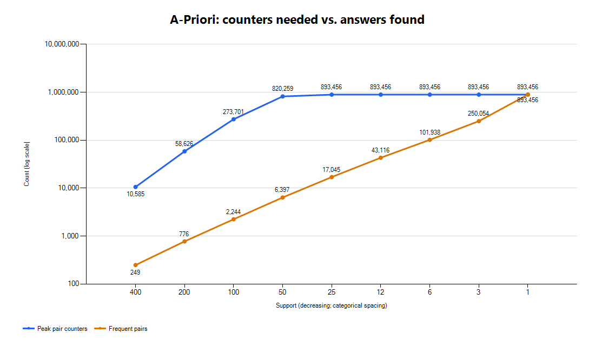
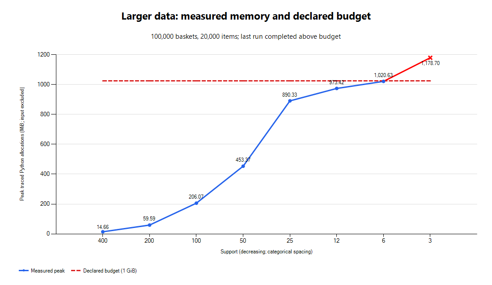

# Week 6: support를 낮췄을 때의 변화

## 측정 환경과 방법

- 측정일: 2026-10-26 (한국 시간).
- CPU: AMD Ryzen 5 7500X3D, 6코어 / 12논리 프로세서.
- RAM: 사용 가능한 물리 메모리 총 33.46GB (31.16GiB), 측정 시작 시 여유 약 17.10GB.
- Windows 11, Python 3.14.7, 64비트.
- 함께 실행 중이던 프로세스: WSL(vmmemWSL), Chrome, VS Code, ChatGPT, Explorer, Windows Defender 및 시스템 메모리 압축. 다른 작업을 종료하지 않은 실제 작업 환경이다.
- 제공된 `bench.build()`의 seed=246, 20,000 baskets, 2,000 items, 평균 추출 횟수 20을 그대로 사용했다. 장바구니는 집합이므로 실제 고유 상품 수는 추출 횟수보다 작을 수 있다.
- `tracemalloc`은 미리 생성한 입력 장바구니를 제외하고 알고리즘 실행 및 반환 결과에 추가로 필요한 Python 할당의 peak를 측정한다. 아래 시간에는 추적 오버헤드가 포함되며, MB는 1,000,000바이트이다. 전체 프로세스 RAM이나 OS의 working set을 측정한 값이 아니다.

## 실제 측정 결과

원본 수치는 `explosion.json`에 저장했다. support는 400에서 1까지 400배 범위의 9개 값을 조사했다.

| Support | Peak pair counters | Frequent pairs | 시간(초, 추적 포함) | Peak Python MB | Counters / answers |
|---:|---:|---:|---:|---:|---:|
| 400 | 10,585 | 249 | 0.476 | 1.15 | 42.51 |
| 200 | 58,626 | 776 | 0.773 | 6.71 | 75.55 |
| 100 | 273,701 | 2,244 | 1.589 | 28.57 | 121.97 |
| 50 | 820,259 | 6,397 | 2.208 | 107.75 | 128.23 |
| 25 | 893,456 | 17,045 | 2.340 | 107.74 | 52.42 |
| 12 | 893,456 | 43,116 | 2.428 | 109.85 | 20.72 |
| 6 | 893,456 | 101,938 | 2.513 | 126.49 | 8.76 |
| 3 | 893,456 | 250,054 | 3.466 | 163.72 | 3.57 |
| 1 | 893,456 | 893,456 | 4.764 | 334.15 | 1.00 |

가로축은 support를 낮추는 순서의 범주형 축이고 간격은 수치에 비례하지 않는다. 세로축은 로그 눈금이다. 파란 선은 보유 카운터, 주황 선은 빈발 쌍 정답 수이다.

## A2: 어디서 중단했는가

기본 데이터는 support 1까지 모두 완료했으며 최대 334.15MB, 4.764초였다. RAM 부족이나 강제 중단은 발생하지 않았다. 최소 singleton support가 32여서 support 25에서 이미 2,000개 상품이 모두 통과했고, 이후에는 후보 종류가 늘어나지 않는다. 따라서 같은 입력의 support만 낮춰서는 이 기기의 부담 한계를 관측하기 어려웠다.

이를 보완하기 위해 동일한 생성 규칙으로 상품 수와 장바구니 수를 늘린 추가 실험을 수행했다. 기본 데이터의 결과와 확대 데이터의 결과는 분리했으며, 추가 실험의 조건·중단 지점은 아래에 기록한다. 실제 물리 RAM 고갈과 미리 정한 운영 예산 초과를 구분한다.

## A4: 카운터의 증가율

support 400→200→100→50에서 카운터는 각각 **5.54배, 4.67배, 3.00배** 늘었다. 단순히 threshold를 절반으로 낮출 때 카운터가 두 배가 되는 관계보다 빠른 초기 증가다. 빈발 singleton이 늘면 그 조합은 대략 제곱으로 늘지만, 실제 카운터는 관측된 쌍에 대해서만 만들어진다.

50→25에서는 1.09배이고 25 이하에서는 893,456개로 포화됐다. 입력의 상품 수와 관측된 쌍의 종류가 유한하므로, support를 계속 낮춘다고 카운터가 무한히 늘지는 않는다. 가능한 전체 쌍 1,999,000개 중 실제로 관측된 쌍만 저장한다.

## A5: 정답의 증가율과 카운터의 차이

400→200→100→50에서 정답 수는 **3.12배, 2.89배, 2.85배** 늘었다. 카운터 증가와 다르며, support 50에서는 820,259개의 카운터 중 6,397개(약 0.78%)만 정답이다. support를 조금 낮춰 얻는 정답보다, 정답 여부를 알아내기 위해 유지하는 비빈발 후보의 비용이 훨씬 클 수 있다.

반대로 25→12→6→3→1에서는 카운터가 고정된 동안 정답이 17,045→893,456개로 늘었다. support 1에서는 관측된 모든 쌍이 정답이므로 두 곡선이 합쳐진다. 반환 결과 딕셔너리와 frozenset 키도 메모리를 사용하여, 카운터 수가 같아도 peak bytes는 107.74→334.15MB로 증가했다. “정답은 언제나 느리게 증가한다”는 일반화도 이 실측에는 맞지 않는다.

## 재현

`w06-apriori`에서 `python task2_explosion.py --supports 400,200,100,50,25,12,6,3,1`을 실행한다. JSON에는 기존 결과 뒤에 추가되며, 각 support를 마칠 때 저장하므로 뒤의 측정을 중단해도 앞의 결과를 보존한다. 그림은 `powershell -ExecutionPolicy Bypass -File plot_results.ps1`로 생성한다(Windows 기본 .NET 차트 라이브러리 사용).

## A2 보완 — 확대 데이터에서의 중단 지점

### 추가 실험 조건

- 100,000 baskets, 20,000 items, 평균 추출 20, seed 246. 기본 실험보다 장바구니는 5배, 상품 수는 10배이다.
- Zipf 가중치 `1/(i+1)^0.8`, 바구니 크기 생성, planted pair 25개와 삽입 확률 0.08을 원본과 같게 유지했다. 누적 가중치는 미리 계산해 데이터 생성 비용을 줄였다. 원래 크기로 생성했을 때 `bench.build()`와 장바구니 전체가 같은지도 확인했다.
- `bench.py`와 `PlainApriori`는 수정하지 않았다. 별도 `task2_stress.py`에서 입력 규모만 바꾸고 동일한 `PlainApriori`를 호출했다. 따라서 위 기본 데이터 표나 Task 3 점수를 확대 데이터 수치로 바꾸지 않았다.
- 같은 PC에서 측정했고, 추가 실험 시작 시 여유 물리 메모리는 약 18.76GB였다. 입력 생성은 시간·메모리 추적에서 제외했다. 시간에는 `tracemalloc`과 예산 검사 비용이 포함된다.
- 중단 기준은 **추가 Python 할당 peak 1GiB(1,073,741,824 bytes) 또는 한 support 실행 60초**로 미리 정했다. 장바구니 256개마다, 각 pass 종료 시, 결과 반환 후에 검사한다. 검사 간 할당과 결과 생성 때문에 예산을 일시적으로 넘을 수 있다.

### 측정 결과

전체 원본 수치는 `stress.json`이다. 모든 행은 결과 계산까지 완료했으며, 마지막 행에서 메모리 예산을 초과해 더 낮은 support의 실험을 중단했다.

| Support | Peak pair counters | Frequent pairs | 시간(초) | Peak Python MB | 상태 |
|---:|---:|---:|---:|---:|---|
| 400 | 144,009 | 708 | 2.387 | 15.37 | 완료 |
| 200 | 628,203 | 2,001 | 4.887 | 62.48 | 완료 |
| 100 | 1,953,391 | 5,522 | 8.210 | 216.08 | 완료 |
| 50 | 4,727,736 | 15,102 | 13.619 | 475.39 | 완료 |
| 25 | 9,166,159 | 41,182 | 20.302 | 933.57 | 완료 |
| 12 | 10,170,828 | 121,415 | 21.865 | 1,020.71 | 완료 |
| 6 | 10,172,348 | 325,860 | 26.787 | 1,070.21 | 완료, 예산 이내 |
| 3 | 10,172,348 | 947,587 | 23.113 | 1,235.96 | 결과 반환 후 예산 초과, 이후 중단 |

support 6의 peak는 약 1,020.63MiB로 예산 이내였고, support 3에서는 **1,178.70MiB(약 1.24GB)**로 넘어섰다. 먼저 도달한 중단 조건은 시간 60초가 아니라 추가 메모리 예산이었다. support 3은 결과를 반환한 뒤 예산을 검사해 종료했으므로 정답 947,587개는 완료된 값이며, 미완료 계산의 추정값이 아니다. 1GiB 예산이 실제 물리 RAM 전부라는 뜻은 아니며, **물리 RAM 고갈 한계를 측정한 것은 아니다.**

### 증가율과 의미

확대 데이터에서 support 400→200→100→50의 카운터 증가율은 4.36→3.11→2.42배였다. support 25에서는 9,166,159개 카운터를 유지해 정답 41,182개를 찾았으므로, 정답 하나당 약 222.58개의 카운터가 필요했다. 단순히 더 많은 정답을 원해 threshold를 낮추면 큰 후보 비용이 생긴다는 현상을 기본 실험보다 큰 규모에서 확인했다.

12 이하에서는 카운터가 거의 포화되는 반면, 반환하는 빈발 쌍은 계속 늘었다. 이 구간에서 출력 딕셔너리와 frozenset 키의 메모리도 커졌고 support 3에서 예산을 넘었다. 시간은 한 조건당 한 번 측정한 wall time이라 증가가 항상 단조롭지는 않다. support 6보다 3의 시간이 짧았다는 사실을 일반적인 속도 향상으로 해석하지 않는다.

추가 실험은 `python task2_stress.py`로 재현한다. 결과는 기본 `explosion.json`과 분리된 `stress.json`을 갱신하며, 예산을 넘긴 첫 조건에서 이후 측정을 중단한다. `completed_over_budget`는 결과를 반환한 뒤 예산을 넘은 경우, `stopped`는 결과 생성 전에 중단된 경우로 구분한다.
