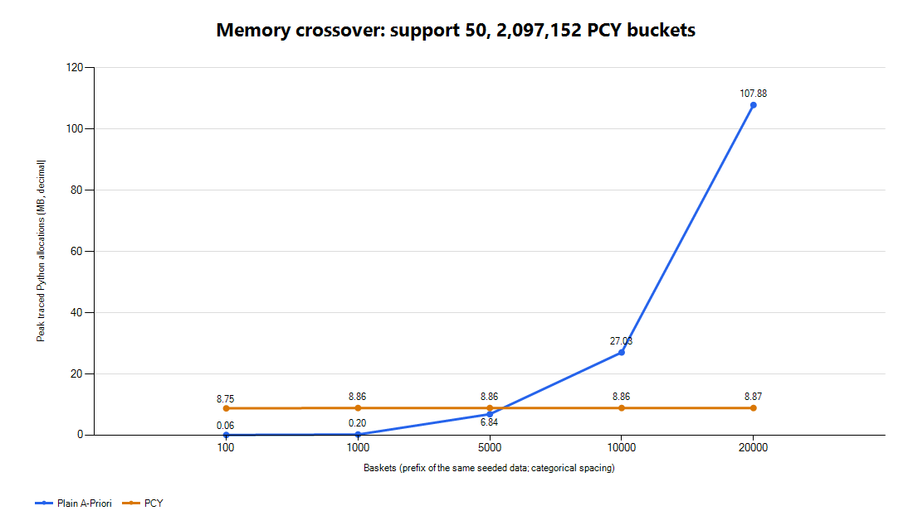

# PCY의 버킷 비용과 실제 메모리 교차점

## 구현과 정확성

Pass 1에서 singleton과 모든 관측 쌍의 hash bucket을 센다. 임의의 hashable 상품에 정수 ID를 부여하고 정렬한 ID 쌍의 hash를 두 pass에서 동일하게 사용한다. 버킷 값은 support에서 포화시켜도 빈발 여부가 변하지 않는다.

Pass 1 종료 후 32비트 버킷 카운터를 **1 bucket = 1 bit** bitmap으로 압축하고 정수 배열을 해제한다. Pass 2에서는 두 상품 모두 빈발이고 bitmap도 통과한 쌍만 정확한 카운터를 생성한다. hash 충돌은 후보를 추가할 수 있지만 실제 빈발 쌍을 제거할 수는 없다. 마지막에는 정확한 support로 다시 필터링한다.

`peak_counters`는 정확한 **pair별 카운터** 수이다. 버킷은 여러 쌍을 합친 카운터이므로 별도로 아래에 메모리를 기록한다. 제공된 `bench.py`는 수정하지 않았다. `measure_pcy.py`에서는 정답 집합뿐 아니라 각 쌍의 support count까지 baseline과 비교했고 모두 같았다.

## 버킷 수를 줄인 실험

20,000 baskets, 2,000 items, support 50. 원본은 `pcy_memory.json`이다.

| Buckets | 정수 버킷 bytes | Bitmap bytes | 빈발 buckets | Peak pair counters | 카운터 감소 | Peak Python MB |
|---:|---:|---:|---:|---:|---:|---:|
| 16,384 | 65,536 | 2,048 | 16,384 | 820,259 | 0.00% | 107.93 |
| 131,072 | 524,288 | 16,384 | 11,661 | 84,925 | 89.65% | 10.03 |
| 2,097,152 | 8,388,608 | 262,144 | 6,466 | 7,243 | 99.12% | 8.87 |

모든 실험에서 빈발 쌍은 6,397개였다.

16,384 buckets에서는 충돌로 모든 bucket이 빈발이 되어 bitmap이 아무것도 제외하지 못했다. 배열이 작다고 전체 메모리도 반드시 작아지는 것은 아니다. 기본값 2,097,152는 이 데이터에서 pair counters를 99% 이상 줄이고, 131,072개를 썼을 때보다 실측 전체 추가 메모리도 작았기 때문에 선택했다. 모든 데이터에서 최적이라는 의미는 아니다.

기본 정수 배열은 8,388,608 bytes(8MiB), bitmap은 262,144 bytes(0.25MiB)이다. 압축 중에는 두 배열이 함께 존재하므로 배열만 8,650,752 bytes가 필요하다. 추가로 singleton Counter, ID 딕셔너리, pair의 tuple 키와 딕셔너리, 반환 결과의 frozenset 키 등이 필요하다. 최종 결과를 포함한 실측 peak는 약 8.87MB였다. baseline의 같은 조건 측정은 107.88MB이므로, pair counters의 99.12% 감소와 전체 추가 메모리의 약 91.78% 감소를 구분한다.

## 데이터 크기에 따른 교차점

같은 seed의 입력에서 앞의 n개 장바구니를 사용하고 **support는 절대값 50으로 고정**했다. 입력과 비교용 정답은 측정 전에 생성했고, `tracemalloc`은 알고리즘 실행·결과 생성에서 추가되는 Python 할당만 추적했다.

| Baskets | Baseline counters | PCY counters | Baseline peak MB | PCY peak MB |
|---:|---:|---:|---:|---:|
| 100 | 0 | 0 | 0.06 | 8.75 |
| 1,000 | 1,078 | 59 | 0.20 | 8.86 |
| 5,000 | 50,168 | 823 | 6.84 | 8.86 |
| 10,000 | 212,340 | 2,325 | 27.03 | 8.86 |
| 20,000 | 820,259 | 7,243 | 107.88 | 8.87 |

이번 측정에서 메모리 우위가 바뀌는 지점은 **5,000개보다 크고 10,000개 이하**인 구간에 있다. 작은 데이터에서는 고정 8MiB 배열이 부담이고, baseline의 pair 딕셔너리 비용이 고정 배열 비용을 넘으면 PCY가 유리하다. 정확한 최초 n은 측정하지 않았으며, threshold, 상품 수, 인기 편중, bucket 수, Python 객체 크기에 따라 달라진다.

데이터가 증가해도 PCY의 전체 비용이 영원히 고정된다는 의미는 아니다. 고정된 것은 bucket과 bitmap 용량이며, 충돌이나 실제 빈발 쌍이 늘면 Pass 2의 딕셔너리도 커진다. 모든 bucket이 빈발이 되면 필터 효과가 사라진다.

## 시간과 재현

`out/bench.txt`의 추적 없는 실행에서는 baseline 약 1.00초, PCY 약 1.81초였다. 개선 대상은 메모리이며, 이 PCY 구현은 hash·bitmap 처리 때문에 더 느렸다. `pcy_memory.json`의 시간에는 `tracemalloc` 오버헤드가 포함되어 있으므로 이 시간과 직접 비교하지 않는다.

`python measure_pcy.py`로 bucket 실험·교차점·규칙의 수치를 다시 측정한다. 그림은 `powershell -ExecutionPolicy Bypass -File plot_results.ps1`로 생성한다. 모든 실험에서 정답 딕셔너리의 일치를 확인한다.
